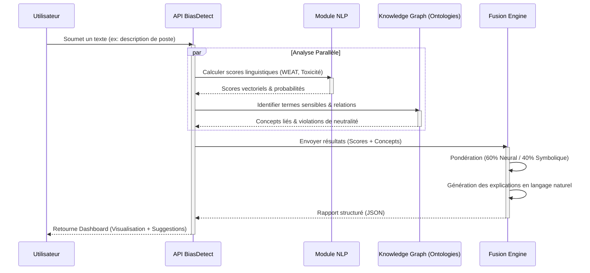

# Architecture du Système BiasDetect-LLM

Ce document détaille l'architecture technique du système hybride de détection de biais.

## 1. Architecture Globale (Vue Haut-Niveau)

Le diagramme ci-dessous illustre l'approche hybride combinant analyse linguistique (neuronale/statistique) et connaissances symboliques (ontologies).

```mermaid
graph TD
    UserInput[INPUT: Texte généré par LLM] --> Splitter{Dispatcheur}

    subgraph "Branche 1 : Analyse Linguistique"
        Splitter --> Embeddings[Analyse d'Embeddings]
        Splitter --> WEAT[Tests d'Associations (WEAT/SEAT)]
        Splitter --> Stylometry[Analyse Stylométrique]
    end

    subgraph "Branche 2 : Analyse Symbolique (Ontologies)"
        Splitter --> EntityRec[Reconnaissance d'Entités]
        EntityRec --> OntoGenre[Ontologie: Genre]
        EntityRec --> OntoCulture[Ontologie: Culture]
        EntityRec --> OntoRep[Ontologie: Représentation]
    end

    Embeddings --> Merger((Fusion Hybride))
    WEAT --> Merger
    Stylometry --> Merger
    OntoGenre --> Merger
    OntoCulture --> Merger
    OntoRep --> Merger

    Merger --> ScoringEngine[Moteur de Scoring]
    
    subgraph "Module d'Explicabilité"
        ScoringEngine --> ExplainGen[Générateur d'Explications]
        ExplainGen --> Highlight[Surlignage Token/Phrase]
        ExplainGen --> Context[Contextualisation Ontologique]
    end

    ExplainGen --> FinalOutput[OUTPUT: Rapport de Biais]

    style UserInput fill:#f9f,stroke:#333,stroke-width:2px
    style FinalOutput fill:#9f9,stroke:#333,stroke-width:2px
    style Merger fill:#ff9,stroke:#333,stroke-width:4px
```

## 2. Flux de Traitement Détaillé

Ce diagramme de séquence montre comment une requête est traitée étape par étape.



## 3. Détail des Composants

### Branche Linguistique
- **Embeddings** : Utilisation de modèles comme BERT ou RoBERTa pour capter le contexte.
- **WEAT/SEAT** : Mesure de la distance cosinus entre concepts cibles (ex: Mathématiques vs Arts) et attributs (ex: Homme vs Femme).

### Branche Symbolique
- **Ontologies** : Bases de connaissances structurées (RDF/OWL) définissant des règles normatives.
    - *Exemple* : `Infirmier` ↔ `Neutralité attendue` mais souvent associé à `Femme` dans les données.

### Fusion Hybride
Le moteur de fusion applique une somme pondérée dynamique :
$$ Score_{Final} = \alpha \cdot Score_{Neural} + (1-\alpha) \cdot Score_{Symbolique} $$
Où $\alpha$ est ajustable selon le domaine (ex: Médical vs Juridique).
